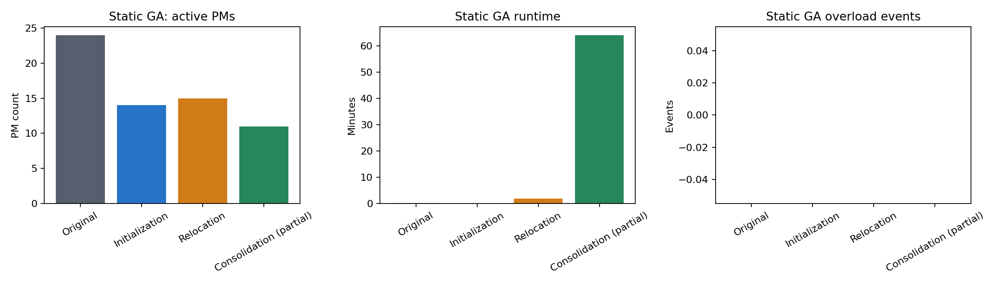
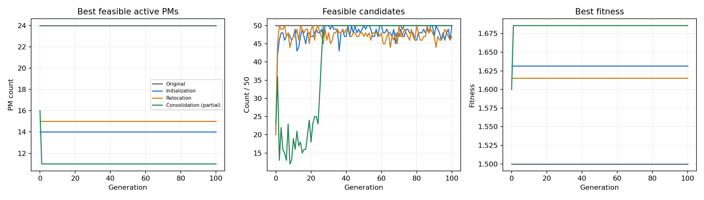
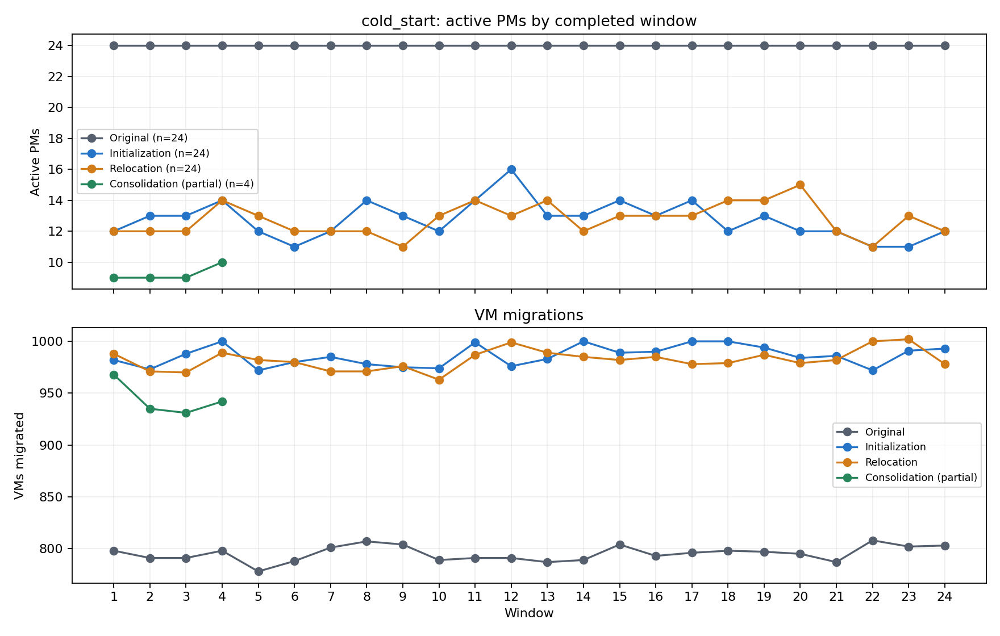
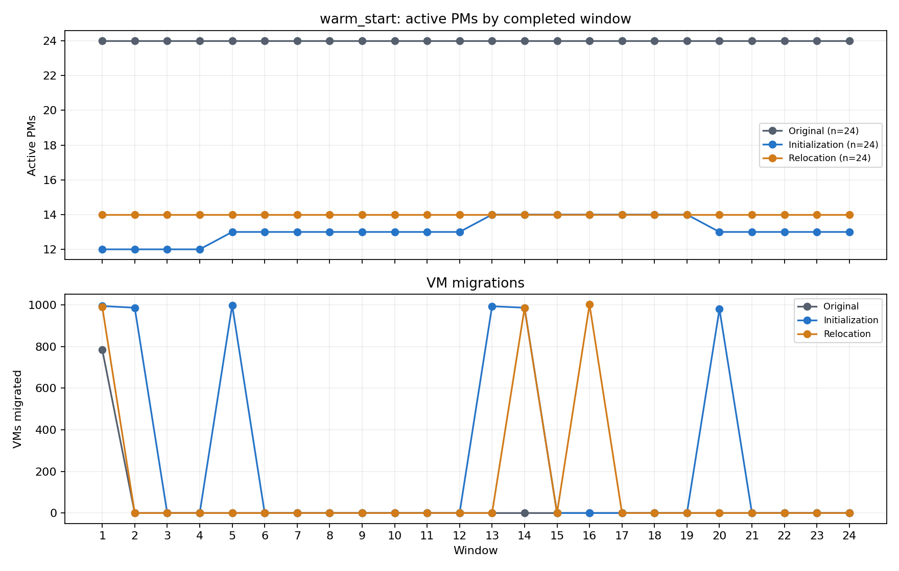

# Available evaluation results

Seed 42, single-run observations. Consolidation results are partial; no winner claim.

## Static GA

| Variant | Status | Active PMs | Overload events | Migrations | Runtime (min) |
|---|---|---:|---:|---:|---:|
| Original | FEASIBLE | 24 | 0 | 987 | 0.14 |
| Initialization | FEASIBLE | 14 | 0 | 990 | 0.09 |
| Relocation | FEASIBLE | 15 | 0 | 984 | 1.91 |
| Consolidation (partial) | FEASIBLE | 11 | 0 | 979 | 64.21 |

## Dynamic progress

| Variant | Cold windows | Warm windows | Cold feasible | Warm feasible |
|---|---:|---:|---:|---:|
| Original | 24/24 | 24/24 | 24/24 | 24/24 |
| Initialization | 24/24 | 24/24 | 24/24 | 24/24 |
| Relocation | 24/24 | 24/24 | 24/24 | 24/24 |
| Consolidation (partial) | 4/24 | 0/24 | 4/4 | 0/0 |

Full 24-window tracks exist for Original, Initialization, and Relocation. Consolidation has 4 completed cold-start windows; warm-start has not begun. Missing windows are not plotted as zero or inferred.

Consolidation static GA completed. Its dynamic run remains partial. Plots show available saved artifacts only; they do not represent a completed four-variant dynamic comparison.
