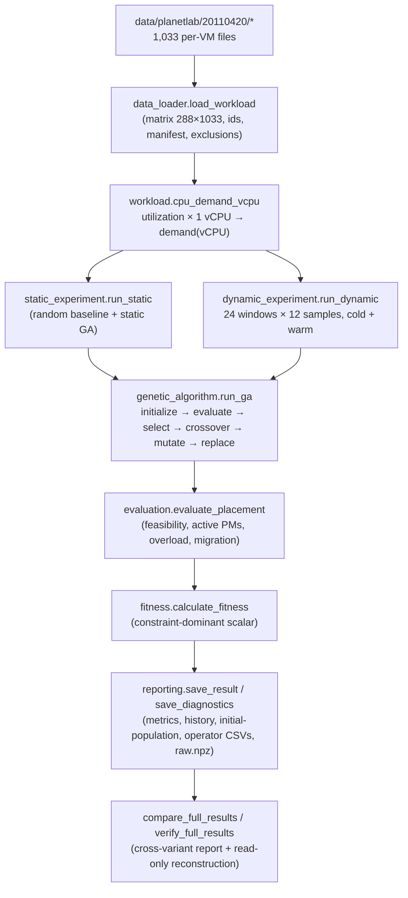

# Experiment 1 — Active-PM-Aware Initialization in a GA for Server Consolidation

Deep technical investigation of branch `experiment/active-pm-aware-initialization`.

This document is self-contained and intended to be transferred into another AI conversation as the primary technical context for continuing this research and writing a paper. Verified facts are cited to file and line. Inferred explanations and unresolved items are labeled as such.

---

## 1. Executive Summary

The repository solves the **Virtual Machine consolidation (server consolidation) problem** — allocate 1,033 PlanetLab VMs to a smaller set of Physical Machines (PMs) so that the number of active PMs is minimized without violating per-PM CPU capacity at any evaluation timestamp. The optimizer is a **genetic algorithm (GA)**.

Three experiments are isolated on three branches against an unmodified "original GA" baseline on `main`:

| Branch | Experiment |
|---|---|
| `experiment/active-pm-aware-initialization` | **Experiment 1** — active-PM-aware (compact) initialization |
| `experiment/feasibility-preserving-relocation` | Experiment 2 — feasibility-preserving relocation mutation |
| `experiment/consolidation-aware-mutation` | Experiment 3 — consolidation-aware mutation |

**Experiment 1 changes exactly one thing: the population initialization.** The original GA initializes every chromosome by uniform random assignment of each VM to any of the 24 PMs. Experiment 1 replaces it with a mixture: **40 "compact" chromosomes** (each restricted to a random *subset* of PMs, biasing toward fewer active PMs) plus **10 uniform chromosomes** (preserving diversity). Warm-start windows inherit the previous window's selected placement plus 39 compact + 10 uniform.

**Key result (single seed 42, descriptive, not statistically established):**

- Original GA is **unable to consolidate**: static GA stays at **24/24 active PMs**, and every dynamic window stays at 24 active PMs (warm-start barely migrates).
- Experiment 1 static GA consolidates to **14 active PMs** (maximum PM utilization 79.06%, just under the 80% safe threshold). Dynamic cold-start uses **11–16 PMs (mean 12.75)**; warm-start **12–14 PMs (mean 13.125)**.
- The 14-PM solution is already present **at generation 0** of the compact initialization. Evolution adds no further consolidation — it only raises population feasibility.
- Trade-off: consolidation raises migration counts. Experiment 1 warm-start migrates 5,942 VMs over 24 windows (rate 0.240) vs 785 (rate 0.032) for the original GA, which barely moves after window 1.

**Critical implementation finding:** "Active-PM-aware initialization" is **not** a CPU-utilization-aware packing heuristic. There is no first-fit/best-fit, no threshold enforcement, and no time-series demand consideration inside the initializer. "Compact" means: pick a random subset of PM IDs (size 1…23), then assign each VM uniformly to one of that subset. This reduces the *allele range* per chromosome, which statistically lowers the active-PM count, but **does not guarantee feasibility** (infeasible candidates are retained by design).

---

## 2. Research Context

### 2.1 Server consolidation problem

Server consolidation packs VMs onto the fewest active PMs. Formalize:

- $N$ VMs, each with CPU demand time series $d_{i}(t)$, $t \in \{1,\dots,T\}$.
- $M$ PMs, each with CPU capacity $C$ (vCPU) and a safe operating threshold $\tau \in (0,1)$.
- A placement assigns each VM $i$ to exactly one PM $p(i) \in \{1,\dots,M\}$.
- A placement is feasible iff, for every PM and every timestamp, $\sum_{i: p(i)=j} d_i(t) \le \tau \cdot C$.
- Objective: minimize the number of active PMs $| \{j : \exists i, p(i)=j\} |$, and (in dynamic mode) the migrations from a reference placement.

Motivation: fewer active PMs = lower energy and higher utilization, without violating workload constraints.

### 2.2 Dataset (PlanetLab)

| Property | Value | Source |
|---|---|---|
| VMs | 1,033 | config `dataset.expected_vm_count`; `observed_vms` |
| CPU samples per VM | 288 | `dataset.expected_samples_per_vm`; `observed_samples` |
| Sampling interval | 5 minutes | `dataset.sample_interval_minutes` |
| Workload date | 20110420 | `dataset.provenance.workload_date` |
| Provenance | beloglazov/planetlab-workload-traces @ `344ffdb…` | `dataset.provenance` |

Observed aggregate CPU demand (vCPU), from `outputs/full_seed42/initialization/summaries/experiment_config.json` `observed_dataset`:

- mean aggregate demand: **107.753 vCPU**
- max aggregate demand: **123.88 vCPU**
- min aggregate demand: **93.37 vCPU**
- mean per-sample VM utilization (ratio): 0.1043; max single sample 0.99, min 0.0.

Simulation assumptions (recorded in `README.md` and config): each VM has capacity **1 vCPU**; each PM capacity **16 vCPU**; safe threshold **0.80**; hence effective safe capacity **12.8 vCPU per PM** (16 × 0.80). These are *simulation assumptions*, not PlanetLab-provided allocation metadata.

**Aggregate lower bound (verified).** $\mathrm{PM}_{min} = \lceil 123.88 / 12.8 \rceil = \lceil 9.678 \rceil = 10$. This matches `HOW-TO-RUN.md` lines 106–110. This is a *necessary* aggregate bound. It is **not sufficient**: a feasible placement must satisfy the pointwise per-PM constraint at every one of the 288 timestamps, and VMs are indivisible 1-vCPU units. The GA found **14** PMs, not 10. Whether fewer than 14 is achievable is **NOT VERIFIED** (no exact solver was run).

---

## 3. Research Problem

The original GA (uniform random initialization) is a weak consolidator. With 1,033 VMs uniformly scattered over 24 PMs, **every** initial chromosome activates all 24 PMs (probability that all 24 are touched is ~1). The fitness function *rewards* fewer active PMs, but the GA's operators (uniform crossover + per-gene random reassignment) have no consolidation bias: a random per-gene move to a random PM keeps VMs spread. Escaping the 24-PM basin would require many coordinated moves simultaneously — which the operators do not provide. The search therefore stalls at 24 PMs regardless of generations.

Experiment 1 tests the hypothesis that **seeding the population with more compact allocations** ("active-PM-aware" initialization) lets the GA start in — or near — higher-fitness, lower-active-PM regions that the operators alone cannot reach.

*The result (14 PMs present at generation 0, and never improved afterward) shows the initialization, not the evolutionary search, delivered the consolidation.*

---

## 4. Repository and Git Architecture

Verified paths (differ from the assumed ones in the task brief):

- Project root (`git rev-parse --show-toplevel`): `/mnt/e/.TEMPORARY/Project STMH`
- Current branch (`git branch --show-current`): `experiment/active-pm-aware-initialization`
- Current HEAD: `ed24a32` ("delete: clean output from initial GA method experiment and running with new visualization")

**Discrepancy — assumed worktree does not exist.** The brief expected the experiment worktree at `/home/qadrillah/.local/share/opencode/worktree/de2f85/ga-active-pm-init`. That path **does not exist** (`ls` fails). `git worktree list` shows only one worktree: the main checkout at `/mnt/e/.TEMPORARY/Project STMH`, on the experiment branch. `EXPERIMENT_DECISIONS.md` line 73 and `consolidation_experiment_validation.md` line 68 reference that worktree path; commit `c7f1915` message ("auto-save sebelum worktree dihapus") indicates the worktree was deleted after auto-saving. The experiment branch is currently checked out directly in the repo root.

Commit history (branch):

```text
ed24a32 delete: clean output from initial GA method experiment and running with new visualization
c7f1915 wip: active-pm-aware-initialization implementation + results (auto-save sebelum worktree dihapus)
21cf4c1 feat: first experiment with initial parameter
9a9766c try: experiment with 24 PM
066678f Add output layout, organization, and visualization modules
7d8da57 initial commit
```

Branches present: `main` (original GA), `experiment/active-pm-aware-initialization`, `experiment/feasibility-preserving-relocation`, `experiment/consolidation-aware-mutation`.

`git merge-base HEAD main` = `21cf4c1`. So `21cf4c1` is the common foundation; commits `c7f1915` and `ed24a32` are experiment-only, and `main` carries the original GA.

`git diff --stat main...HEAD` isolates the experiment's tracked changes. Source-level delta vs `main` is small: `src/genetic_algorithm.py` (+54), `src/experiment.py` (+5/−5), `src/reporting.py` (+10), `src/diagnostics.py` (new, +63), plus tests (`test_initialization_policy.py` +65, `test_controlled_integration.py` +70, `test_schema_contract.py` +35, `test_foundation.py` +14, `test_ga.py` ±7) and two scripts (`verify_full_results.py`, `visualize_available.py`). The remaining ~2,200 changed files are output artifacts (reorganized/deleted figures and JSON).

**Provenance of the results.** The seed-42 results under `outputs/full_seed42/` were produced by `evaluate_frozen.py` at HEAD **`21cf4c1` + uncommitted working-tree edits**, frozen in `outputs/full_seed42/provenance/*`. `provenance/initialization/status.txt` lists the modified/untracked files (uncommitted `genetic_algorithm.py`, `experiment.py`, `reporting.py`, `configs/controlled_24.yaml`, new `src/diagnostics.py`, new tests, `evaluate_frozen.py`). `provenance/original/status.txt` shows the original arm only added instrumentation (`reporting.py`, `diagnostics.py`, `controlled_24.yaml`, `evaluate_frozen.py`) with **no** change to its `genetic_algorithm.py`. So the two arms differ algorithmically *only* in initialization. Commit hashes alone do **not** identify the variant implementations — the uncommitted snapshots do.

---

## 5. Codebase Structure

Actual layout (excluding `.venv`):

```text
/mnt/e/.TEMPORARY/Project STMH
├── data/planetlab/20110420/          one file per VM (1,033 files)
├── outputs/
│   ├── full_seed42/                  frozen seed-42 comparison workspace
│   │   ├── initialization/           Experiment 1 results
│   │   ├── original/                 original GA baseline results
│   │   ├── relocation/               Experiment 2 (from its worktree)
│   │   ├── consolidation/            Experiment 3 (from its worktree)
│   │   ├── available_results_visualizations/
│   │   └── provenance/               frozen source + HEAD/status per arm
│   ├── consolidation_experiment_validation.md
│   └── validation_evidence/
├── server_consolidation_ga/
│   ├── configs/
│   │   ├── experiment_config.yaml    12 PM — LEGACY fixtures only
│   │   ├── controlled_24.yaml        24 PM — approved comparison
│   │   ├── initialization_p24.yaml   24 PM
│   │   └── experiment_p{6,8,24}.yaml PM-count sweep configs
│   ├── src/                          algorithm + pipeline (below)
│   ├── tests/                        acceptance + policy tests
│   ├── main.py                       canonical entry (12-PM path)
│   ├── evaluate_frozen.py            runs one frozen full experiment
│   ├── compare_full_results.py       cross-variant comparison report
│   ├── verify_full_results.py        read-only metric reconstruction
│   ├── organize_outputs.py, visualize_available.py
│   ├── README.md, HOW-TO-RUN.md, DIAGNOSTIC_SCHEMA.md,
│   │   EXPERIMENT_DECISIONS.md, OPEN_DECISIONS.md, requirements.txt
│   └── outputs_p24*/                 earlier per-branch outputs
├── 1-EDA-PlanetLab Makro.ipynb
├── 2-EDA-PlanetLab Mikro.ipynb
├── 3-Experiment GA.ipynb
└── GA_Server_Consolidation_EN_v4_RENDER_READY.md   original spec v4.0
```

`src/` modules (25 files, ~1,300 substantive lines):

| File | Responsibility | Exp 1 / shared |
|---|---|---|
| `config.py` (147) | Strict YAML loading + validation; locks methodology | shared |
| `data_loader.py` (58) | Reads per-VM files → samples×VM matrix, manifest, exclusions | shared |
| `data_validation.py` (15) | Range/finiteness check per scale (percentage/ratio) | shared |
| `workload.py` (14) | utilization → vCPU demand (`util × vm_capacity`) | shared |
| `placement.py` (23) | Validate placements; per-PM-per-sample loads | shared |
| `evaluation.py` (40) | `evaluate_placement`: feasibility + all metrics | shared |
| `fitness.py` (17) | `calculate_fitness` (constraint-dominant) | shared |
| `selection.py` (20) | Tournament + elite selection | shared |
| `crossover.py` (16) | Uniform crossover | shared |
| `mutation.py` (17) | Random-reassignment mutation | shared |
| `randomness.py` (16) | PCG64 streams keyed `(role_id, window)` | shared |
| `genetic_algorithm.py` (116) | **`initialize_population`, `reproduce`, `run_ga`** | **Exp 1 (init changed)** |
| `diagnostics.py` (63) | `observe` decorator; measurement-only counters | Exp 1 (new) |
| `experiment.py` (98) | Orchestration + incremental persistence | shared (+ variant label) |
| `static_experiment.py` (23) | Static baseline + static GA | shared |
| `dynamic_experiment.py` (32) | 24-window cold/warm controller | shared |
| `reporting.py` (117) | CSV/NPZ persistence, `dynamic_summary` | shared (+ diagnostics columns) |
| `output_layout.py`, `output_organization.py`, `output_documentation.py`, `visualization.py`, `result_visualization.py` | Output layout, reorganization, README generation, figures | shared |

`evaluate_frozen.py` is the script that produced the `full_seed42/*` results; `verify_full_results.py` recomputes every saved metric from raw placements (read-only proof); `compare_full_results.py` renders the 4-variant comparison.

---

## 6. End-to-End Algorithm Workflow

The execution flow, reconstructed from source:



`run_ga` is wrapped by `diagnostics.observe` (genetic_algorithm.py:114–116), which counts fitness/feasibility evaluations and reproduction timings without changing RNG consumption or search behavior.

One static run = generation 0 + `max_generations` (100) reproduction updates = **101 evaluated generations**. Dynamic = 24 cold-start + 24 warm-start windows, each a full 101-generation `run_ga`. Total GA optimizations per arm = **1 + 24 + 24 = 49**.

---

## 7. Chromosome Representation

Verified from `placement.py` and `genetic_algorithm.py`.

- A placement is an **integer vector of length $N$** (number of VMs). Gene $i$ holds the PM ID (1-based) of VM $i$. `validate_placement` (placement.py:6–12) enforces shape `(vm_count,)`, integer dtype, and range $[1, \mathrm{pm\_count}]$.
- **Unused PM indices are legal and common** — a PM is "active" iff at least one VM maps to it. `evaluate_placement` computes $\text{active} = \mathrm{len}(\mathrm{np.unique}(placement))$ (evaluation.py:13).
- Changing the number of available PMs changes the *allele range*, never the chromosome length. With 1,033 VMs the chromosome always has 1,033 genes.

Example ($N=5$, gene value = PM ID):

```text
VM:          VM1 VM2 VM3 VM4 VM5
Chromosome:   0   1   0   2   1     ← conceptual; code uses 1-based labels
```

In 1-based labels this is `[1, 2, 1, 3, 2]`. PM1 = {VM1, VM3}, PM2 = {VM2, VM5}, PM3 = {VM4}. Active PMs = 3 (`np.unique == {1,2,3}`). If PM4..PM24 exist but are untouched, they are inactive and excluded from mean-active-utilization (evaluation.py:29).

---

## 8. Fitness Function and Mathematical Formulation

From `fitness.py:4–17` and `evaluation.py:8–40`. Fitness is **maximized** and **constraint-dominant** (any feasible solution outranks any infeasible one).

Definitions per placement, given demand matrix and (optional) reference:

- utilization per (PM $j$, sample $t$): $u_{jt} = \frac{\mathrm{load}_{jt}}{C}$, $C=16$ vCPU (evaluation.py:16, 36).
- overload above threshold: $\mathrm{over}_{jt} = \max(0,\, u_{jt} - \tau)$, $\tau = 0.80$ (evaluation.py:17).
- normalized CPU violation $V$ (evaluation.py:18):

$$V = \frac{1}{T \cdot M} \sum_{t} \sum_{j} \left( \frac{\mathrm{over}_{jt}}{1 - \tau} \right)^{2}$$

- Feasibility (evaluation.py:20–21): pointwise hard limit **and** negligible aggregate violation:

$$\mathrm{feasible} \iff \big( \forall j,t: \mathrm{load}_{jt} \le \tau C + \mathrm{tol} \big) \;\wedge\; \big( V \le \mathrm{tol} \big), \quad \mathrm{tol}=10^{-9}$$

- active PM count: $\alpha = |\{j : \exists i,\, p(i)=j\}|$.
- migration count (dynamic, evaluation.py:23–25): $\mu = |\{i : p(i) \ne r(i)\}|$ where $r$ is the reference; normalized $\bar{\mu} = \mu / N$.
- server cost: $c_s = \alpha / M$ (fitness.py:11).
- dynamic cost blends server and migration (fitness.py:12–16):

$$c = w_s \cdot c_s + w_m \cdot \bar{\mu}, \qquad w_s = 0.70,\; w_m = 0.30$$

Fitness (fitness.py:7–17):

$$
F =
\begin{cases}
1 + \dfrac{1}{1 + c}, & \text{FEASIBLE}\\[6pt]
\dfrac{1}{1 + V}, & \text{INFEASIBLE}
\end{cases}
$$

Interpretation:

- Feasible fitness lies in $(1, 2]$, decreasing in $c$; fewer active PMs (and, dynamically, fewer migrations) → higher fitness. At $c=0$ (impossible: $\alpha \ge 1$), $F=2$; at $c=1$ ($\alpha=M$), $F=1.5$.
- Infeasible fitness lies in $(0, 1]$, decreasing in $V$, so a large violation ranks worse.
- Constraint dominance: feasible minimum $>1$ beats infeasible maximum $\le 1$. Selection therefore prefers *any* feasible placement over *any* infeasible one, then balances consolidation, then migration.

**Static mode excludes migration from the objective** (`include_migration_in_objective: false`; fitness.py:12). Static migration (`990` for initialization) is recorded but not optimized.

**Overload counting** is deliberately strict: an "overload event" is a $(j,t)$ pair with $u_{jt} > \tau$ (evaluation.py:32), *not* $\ge$ and *not* the violation $V$. Feasibility uses the +tol soft equality; overload metrics use the strict inequality. See `OPEN_DECISIONS.md` lines 33–35.

---

## 9. Selection Mechanism

`selection.py:6–12` (`tournament`) and `15–20` (`elite_indices`).

- **Tournament selection, size 3**, sampling **with replacement** (participants drawn via `rng.integers(0, len(fitness), size=3)`, which permits repeats).
- Winner = participant with max fitness; ties broken **randomly** among equal-max participants (`rng.choice(participants[scores == scores.max()])`).
- Two parents are drawn independently (genetic_algorithm.py:36), then crossed and mutated into offspring until the population is refilled.
- **Elitism**: `elite_indices` returns the top `elitism_count` (=2) individuals; `reproduce` seeds the child population with byte copies of the two elites (genetic_algorithm.py:34), which survive unchanged.
- **Best-so-far** is tracked separately from population best: `best_fitness` updates only on *strict* improvement (`fitness[candidate] > best_fitness`, genetic_algorithm.py:73), and ties retain the first-seen chromosome (`methodology.best_so_far_ties: first_seen`).

Replacement is **generational**: each generation, the entire next population = 2 elites + 48 offspring from tournament-selected parents (genetic_algorithm.py:34–42). No steady-state, no repair, no migration of the best-so-far back into the population.

---

## 10. Crossover Mechanism

`crossover.py:6–16` (`uniform_crossover`).

- **Uniform crossover**, one probability trial per parent pair (`crossover.probability = 0.80`).
- If the trial fails ($\mathrm{rng} \ge 0.80$), both children are exact copies of the parents (crossover.py:13–14).
- If it fires, an independent **50/50 per-gene mask** is drawn; the two children are complementary:
  - child1 gene $i$ = parentA$[i]$ if mask$[i]$, else parentB$[i]$
  - child2 = mirror (`np.where(mask, a, b)` and `np.where(mask, b, a)`, crossover.py:15–16).

Example ($\text{prob}$ fires, mask = `T F T F …`):

```text
ParentA: [1, 2, 1, 3, 2]
ParentB: [2, 2, 3, 3, 1]
Child1:  [1, 2, 3, 3, 1]   (mask=T → A, F → B)
Child2:  [2, 2, 1, 3, 2]   (mirror)
```

Feasibility is **not** checked or repaired after crossover; infeasible offspring proceed to mutation and are retained if still infeasible.

`reproduce` (genetic_algorithm.py:36–38) makes **one** crossover call per parent pair, then mutates each child.

---

## 11. Mutation Mechanism

`mutation.py:6–17` (`mutate`). Experiment 1 keeps the **original** operator.

- **Random reassignment, per-gene**: each gene independently triggers with probability `per_gene_probability = 0.02`. The mask is drawn once (`mask = rng.random(len(result)) < probability`).
- A triggered gene is reassigned **uniformly to any PM except its current one** (`draws + (draws >= result[mask])`, mutation.py:15–16 — the standard "sample from $[1, M{-}1]$ then map to exclude the current label" bijection). Reassigning to the same PM is thus impossible.
- Feasibility is **not** checked before accepting the mutation; the child is whatever the reassignment produces.

**Trigger probability vs. change probability:** The *trigger* probability is 0.02 per gene. The *placement-change* probability per triggered gene is exactly 1 (it always moves, and always to a different PM). With 1,033 genes, the expected number of mutated genes per chromosome is $1033 \times 0.02 \approx 20.66$; a chromosome is untouched with probability $0.98^{1033} \approx 8.7\times10^{-10}$.

Mutation has **no consolidation bias**: the destination is uniform over all PMs, so a move is as likely to *spread* as to *consolidate*. This is why, once the original GA is in the 24-PM basin, mutation cannot escape it. `compare_full_results.py` line 124 notes the zero operator counters for the initialization arm mean "no new relocation/consolidation operator", not "no random gene mutations".

---

## 12. Active-PM-Aware Initialization (the Experiment)

`initialize_population` (genetic_algorithm.py:15–28) is the **entire** algorithmic change of Experiment 1.

```python
def initialize_population(vm_count, config, rng, inherited=None):
    size = config["genetic_algorithm"]["population_size"]     # 50
    pm_count = config["infrastructure"]["available_pm_count"] # 24
    uniform_count = max(1, size // 5)                         # 10
    chromosomes = [] if inherited is None else [validate_placement(inherited, vm_count, pm_count).copy()]
    compact_count = size - uniform_count - len(chromosomes)   # 40 (cold) / 39 (warm)
    for _ in range(compact_count):
        subset_size = int(rng.integers(1, pm_count))          # uniform in [1, 23]
        subset = rng.choice(pm_count, size=subset_size, replace=False) + 1
        chromosomes.append(rng.choice(subset, size=vm_count)) # VM i → uniform draw from subset
    chromosomes.extend(rng.integers(1, pm_count + 1, size=(uniform_count, vm_count)))
    return np.asarray(chromosomes, dtype=int)
```

### 12.1 How a "compact" chromosome is built

For each compact chromosome:

1. Draw `subset_size` uniformly from $[1, \mathrm{pm\_count}-1] = [1, 23]$.
2. Draw `subset` = `subset_size` distinct PM IDs, **without replacement**, then add 1 (1-based labels).
3. For each of the 1,033 VMs, draw its PM uniformly from `subset`.

Consequences:

- A compact chromosome uses **at most** `subset_size ≤ 23` distinct PM labels, so its active-PM count is bounded above by `subset_size`, whereas a uniform chromosome's allele range is the full 24.
- Assignment is **uniform over the subset** — there is **no** CPU-aware placement: no first-fit/best-fit, no sorting of VMs by demand, no use of average/max/peak/time-series CPU, no 80%-threshold check inside the initializer.
- Because VMs are drawn independently, some subset members can receive zero VMs, so the realized active count is $\le$ `subset_size`. The recorded initial active-PM distribution (below) spans 1…23 for the compact slots.
- A `subset_size` of 1 piles all 1,033 VMs onto one PM → guaranteed infeasible; these are **retained**, not filtered.

### 12.2 Population composition (verified)

Population size 50:

| Scenario | Compact | Uniform | Inherited | Total |
|---|---:|---:|---:|---:|
| Cold-start / static / warm window 1 | 40 | 10 | 0 | 50 |
| Warm windows 2–24 | 39 | 10 | 1 | 50 |

This matches the recorded `initialization_policy` in `experiment_config.json` ("40 compact + 10 uniform; warm 1 inherited + 39 compact + 10 uniform") and `EXPERIMENT_DECISIONS.md` line 30–31. `uniform_count = max(1, size // 5)` and `compact_count = size - uniform_count - len(chromosomes)` derive these exactly (genetic_algorithm.py:20,22).

### 12.3 Verified static initial-population distribution

`outputs/full_seed42/initialization/summaries/experiment_summary.csv` (`static_ga.initial_active_pm_distribution`), active-count → number of chromosomes:

```json
{"1":4,"2":1,"3":2,"4":3,"6":2,"7":2,"8":2,"9":1,"10":1,"11":2,
 "12":3,"13":3,"14":3,"15":1,"16":1,"17":2,"18":1,"19":2,"21":3,"23":1,"24":10}
```

- 10 chromosomes activate all 24 PMs (the uniform slots).
- 40 compact chromosomes activate 1–23 PMs. Sum of counts = 40 (compact) + 10 (24) = 50.
- 4 chromosomes already collapse to **1** active PM (grossly infeasible, retained).

### 12.4 Design rationale (intent vs. evidence)

- **Compact chromosomes** inject consolidation: they can carry low-active-PM candidates directly (exploitation).
- **Uniform chromosomes** preserve diversity and keep the full allele domain reachable (exploration).
- **Inherited chromosome (warm start)** carries the previous window's solution forward.

*Intent* is stated in `EXPERIMENT_DECISIONS.md` §"Compact initialization"; *evidence* is the measured initial distribution and the generation-0 results. The exploitation/exploration framing is the design rationale, not an experimentally proven mechanism.

---

## 13. Cold-Start and Warm-Start Mechanisms

`dynamic_experiment.py:7–32`.

- Window size = 12 samples (`experiments.dynamic.window_size_samples = 12`); 288/12 = **24 windows**. Each sample = 5 min, so a window = 1 hour.
- A **shared initial migration reference** `initial` is drawn once from stream `dynamic_initial` (spawn key `(2,0)`): a random placement of all 1,033 VMs over 24 PMs (dynamic_experiment.py:11–12). Both cold-start and warm-start tracks use the *same* initial reference; `verify_full_results.py:22–24` re-derives it as `Generator(PCG64(SeedSequence(42, spawn_key=(2,0)))).integers(1,25,1033)` and asserts equality.
- **Cold-start** (dynamic_experiment.py:21): `inherited = None` → every window re-initializes from scratch (40 compact + 10 uniform), reference = the shared initial for window 1, then each window's own selected placement for later windows.
- **Warm-start** (dynamic_experiment.py:21): `inherited = reference` for windows ≥ 2 → population = 1 inherited (previous window's selected placement) + 39 compact + 10 uniform. Window 1 uses `inherited=None` (full cold mixture).
- After each window, `reference = result["placement"]` (line 28): each arm's previous selected placement is the next migration reference.

**Migration accounting** includes the initial transition (reference → window 1). `methodology.migration_transitions: include_initial` and README line 58. `migration_rate = total_migrations / (N × n_windows)` (reporting.py:111), i.e., over all 24 transitions including window 1.

If a window's selected placement is INFEASIBLE, it is still kept as the next reference/inherited chromosome (`methodology.infeasible_windows: continue_with_selected`); status is recorded per window. In the seed-42 run all 24 windows of both tracks were FEASIBLE, so this path never fired.

---

## 14. Complete Parameter Configuration

Source files: `configs/controlled_24.yaml` (approved comparison) + effective config in `outputs/full_seed42/initialization/summaries/experiment_config.json`; sizes derived in `genetic_algorithm.py`. Values that are computed/embedded in code (not YAML keys) are marked "embedded".

| Parameter | Value | Source (file:lines / YAML key) |
|---|---:|---|
| Number of VMs | 1,033 | `dataset.expected_vm_count`; observed `observed_vms` = 1033 |
| CPU samples per VM | 288 | `dataset.expected_samples_per_vm`; observed 288 |
| Sampling interval | 5 min | `dataset.sample_interval_minutes` |
| Input scale | percentage (/100) | `dataset.input_scale` |
| VM capacity | 1 vCPU | `infrastructure.vm_cpu_capacity_vcpu` = 1.0 |
| PM capacity | 16 vCPU | `infrastructure.pm_cpu_capacity_vcpu` = 16.0 |
| Available PMs (comparison) | 24 | `infrastructure.available_pm_count` = 24 (controlled_24 / initialization_p24 / experiment_p24; **not** experiment_config = 12) |
| Safe CPU threshold | 0.80 | `infrastructure.safe_cpu_threshold` |
| Effective safe capacity | 12.8 vCPU | embedded: `capacity * threshold` in evaluation.py:20 |
| Population size | 50 | `genetic_algorithm.population_size` |
| Reproduction updates | 100 | `genetic_algorithm.max_generations` (→ 101 generations: 0 + 100) |
| Tournament size | 3 | `genetic_algorithm.tournament_size` |
| Tournament sampling | with replacement | embedded: selection.py:10 |
| Crossover type / prob | uniform / 0.80 | `genetic_algorithm.crossover.{type,probability}` |
| Mutation type / prob | random_reassignment / 0.02 per gene | `genetic_algorithm.mutation.{type,per_gene_probability}` |
| Elitism | 2 | `genetic_algorithm.elitism_count` |
| server_weight / migration_weight | 0.70 / 0.30 | `fitness.{server_weight,migration_weight}` |
| Feasibility tolerance | 1e-9 | `fitness.feasibility_tolerance` |
| Random seed | 42 | `project.master_seed` |
| RNG | PCG64 | `project.rng` |
| Stream IDs (init arm) | static_baseline 500 · static_ga 501 · dynamic_initial 2 · cold 503 · warm 504 | `project.stream_ids` |
| Stream IDs (original arm) | 0 · 1 · 2 · 3 · 4 | original config `stream_ids` |
| Dynamic windows | 24 | 288 / `window_size_samples` 12 |
| Samples per window | 12 | `experiments.dynamic.window_size_samples` |
| Compact (cold) / uniform | 40 / 10 | embedded: genetic_algorithm.py:20,22 |
| Inherited (warm) / compact / uniform | 1 / 39 / 10 | embedded: genetic_algorithm.py:21,22 |
| Compact subset size | uniform[1, pm_count−1] | embedded: genetic_algorithm.py:24 (`rng.integers(1, pm_count)`) |
| Uniform-vs-compact split ratio | size//5 | embedded: genetic_algorithm.py:20 |
| Crossover gene mask prob | 0.5 | embedded: crossover.py:15 |
| Mutation "never same PM" | true | embedded: mutation.py:15–16 |
| Best-so-far tie | first-seen / strict improvement | `methodology.best_so_far_ties`; genetic_algorithm.py:73 |
| Tolerance in feasibility | pointwise + V ≤ 1e-9 | evaluation.py:20–21 |

**Hidden/embedded parameters** (not YAML): the 1/5 compact-vs-uniform split, the $[1,M{-}1]$ compact subset-size range, the 50% crossover mask, the "no same-PM" mutation bijection, the strict $>$ overload counting, and the hard-coded feasibility equality tolerance.

**Locked parameters** (`config.py` rejects divergence): master seed 42, `random_seeds == 1`, PCG64, the entire `methodology:` block, the `preprocessing:` policy, `experiments.*` flags, and the dataset schema. `HOW-TO-RUN.md` §"Parameter yang terkunci" lists them.

---

## 15. Experimental Methodology

Per `EXPERIMENT_DECISIONS.md` (the authoritative comparison protocol):

- **One run per arm, seed 42, PCG64.** No replicates. Statistical inference is explicitly **not** permitted; results are single-run descriptive observations.
- **Isolation**: each arm runs in its own workspace/output dir with disjoint RNG streams. Static/cold/warm optimization roles for initialization = 501/503/504; original = 1/3/4. Shared migration reference = `(2,0)` in every arm.
- **Common conditions across arms**: same 1,033 VMs, same stable VM order, 24 PMs, 16-vCPU PMs, 0.80 threshold, tolerance 1e-9; static evaluates all 288 samples; dynamic evaluates 12 samples/window × 24 windows; population 50, 100 updates + gen 0, tournament 3 with replacement, uniform crossover 0.80, 2 elites, unchanged fitness and selection.
- **Baseline vs. Experiment 1** differ only in `initialize_population` (and the accompanying measurement instrumentation), verified by diffing the frozen provenance sources.
- **Evaluation**: static = one full-day run (baseline + GA); dynamic = cold-start and warm-start tracks.
- **Verification**: `verify_full_results.py` recomputes every metric from raw placements and asserts equality (loads to 1e-12, metrics to 1e-12, fitness, initial-population statuses, per-generation best chromosomes, evaluation counts 5050/5051).

What the reported numbers mean:

- Static metrics = the selected (best-so-far) placement at the end of generation 100.
- Dynamic metrics = per-window selected placements, aggregated by `dynamic_summary` (sums and means over the 24 windows).
- "Best" = best-so-far (strict improvement from generation 0), not the population average and not necessarily the final-generation argmax.

---

## 16. Diagnostic Metrics and Output Files

Contract in `server_consolidation_ga/DIAGNOSTIC_SCHEMA.md`. Key artifacts per arm under `outputs/full_seed42/{initialization,original}/`:

| Path | Contents |
|---|---|
| `summaries/experiment_summary.csv` | 4 rows: `static_baseline`, `static_ga`, `cold_start`, `warm_start` |
| `summaries/experiment_config.json` | resolved config + observed dataset + variant + policy |
| `summaries/random_streams.json` | per-role RNG records (role, window, spawn key, states) |
| `summaries/execution_status.json` | `status`, `wall_seconds`, `peak_rss_kib` |
| `summaries/run_status.csv` | per-method/window status |
| `experiments/static/ga/{metrics.csv, placement.csv, raw.npz, fitness_history.csv, per_generation_metrics.csv, initial_population_metrics.csv, operator_metrics.csv, cost.json}` | static GA artifacts |
| `experiments/static/baseline/…` | random placement reference |
| `experiments/dynamic/initial_placement.csv` | shared migration reference |
| `experiments/dynamic/{cold_start,warm_start}/window_NN/…` | per-window artifacts (49 windows) |
| `experiments/dynamic/{cold_start,warm_start}/per_window_metrics.csv` | 24 rows each |
| `data/` | `workload_matrix.npy`, `vm_order.csv`, `dataset_files.csv`, `dataset_summary.csv`, `data_validation.txt` |

Metric columns (from DIAGNOSTIC_SCHEMA.md §Initial population, §Generations, §Operators, §Summary):

- Initial population: `chromosome_index, status, active_pm_count, mean_active_pm_utilization_ratio, maximum_pm_utilization_ratio, maximum_pm_load_vcpu, overload_events, overload_percentage_pm_time_pairs, maximum_overload_utilization_ratio, total_overload_utilization_ratio, normalized_cpu_violation, migration_count, normalized_migration_cost`.
- Generations: `generation, population_size, best_fitness, feasible_population_count, infeasible_population_count, best_feasible_active_pm_count, mean_feasible_active_pm_count, population_active_pm_counts (semicolon 50 values), unique_active_pm_count_values, best_normalized_cpu_violation`. 101 rows (G+1).
- Operators: 14 counters (all zero for initialization/original — no new operator).
- Dynamic summary: `feasible_windows, infeasible_windows, transitions, migration_count, migration_rate, mean_migrations_per_window, mean_active_pm_count, minimum_active_pm_count, maximum_active_pm_count, mean_runtime_per_window_seconds`.
- Evaluation counts: `fitness_evaluations = 5050` (50 × 101), `feasibility_evaluations = 5051` (5050 + 1 final selected evaluation) per optimization; total 49 × 5050 = **247,450** fitness evaluations per arm.

Units: PM IDs one-based; chromosome indices and generations zero-based; runtimes float seconds; counts integer; migration fields nullable when no reference (static baseline reported 0). Missing cells are empty, never zero-substitutes.

---

## 17. Experimental Results

Single seed 42. Descriptive, no statistical claim.

### 17.1 Static

| Variant | Status | Active PMs | Max util | Max PM load (vCPU) | Overload events | Migrations | Fitness | Runtime (s) |
|---|---|---|---:|---:|---:|---:|---:|---:|---:|
| random baseline (ref) | FEASIBLE | 24 | 0.2806 | 10.45 | 0 | 0 | 1.5 | 0.002 |
| **Original GA** | FEASIBLE | **24** | 0.5819 | 9.31 | 0 | 987 | 1.5 | 8.431 |
| **Experiment 1** | FEASIBLE | **14** | 0.7906 | 12.65 | 0 | 990 | 1.6316 | 5.574 |

Original GA does not consolidate (24 PMs, fitness exactly 1.5). Experiment 1 halves active PMs to 14 and pushes max PM utilization to 79.06% — just under the 80% safe threshold (12.65 / 12.8 = 98.8% of safe capacity on the most-loaded PM).

### 17.2 Dynamic (24 windows, cold vs warm)

| Variant | Track | Feasible | Mean active PMs | Min–max | Migrations (total) | Mean mig/window | Migration rate | Overloads |
|---|---|---:|---:|---:|---:|---:|---:|---:|
| Original | cold | 24/24 | 24.0 | 24–24 | 19,086 | 795.25 | 0.7698 | 0 |
| Original | warm | 24/24 | 24.0 | 24–24 | 785 | 32.71 | 0.0317 | 0 |
| **Exp 1** | cold | 24/24 | **12.75** | 11–16 | 23,664 | 986.0 | 0.9545 | 0 |
| **Exp 1** | warm | 24/24 | **13.125** | 12–14 | 5,942 | 247.58 | 0.2397 | 0 |

- Original GA keeps **all 24 PMs** active every window; its warm-start barely migrates (0 after window 1), so it is effectively static.
- Experiment 1 cold-start reaches 11–16 active PMs (mean 12.75); warm-start 12–14 (mean 13.125).
- Experiment 1 warm-start migration (5,942; rate 0.240) is ~7.6× the original (785; rate 0.032) — the direct cost of actually re-consolidating each window.

### 17.3 Convergence (static per-generation, `per_generation_metrics.csv`)

| Generation | Init: best active / feasible / mean active | Original: best active / feasible / mean active |
|---|---:|---:|
| 0 | 14 / 21 / 21.24 | 24 / 50 / 24.0 |
| 100 | 14 / 50 / 23.52 | 24 / 50 / 24.0 |

The 14-PM solution is **already present at generation 0** (fitness 1.6316) and never improves. Evolution only raises population feasibility (21→50 feasible by ~gen 50). Original never moves off 24.

### 17.4 Resource usage

| Variant | Wall (s) | Peak RSS (MiB) |
|---|---:|---:|
| Initialization | 122.56 | ~199.6 |
| Original | 150.17 | ~197.2 |

(RSS from `execution_status.json` KiB ÷ 1024.)

---

## 18. Comparison with Original GA

Equivalence of conditions (verified): same base commit `21cf4c1`, same instrumentation, same dataset and 24-PM config, same seed 42 and RNG scheme, same fitness/selection/crossover/mutation/replacement, disjoint but deterministically-mapped RNG streams. The **only** algorithmic difference is `initialize_population`.

What changed:

1. **Improved: active-PM consolidation.** Static 24 → 14 (−42%). Dynamic cold 24 → 12.75 mean; warm 24 → 13.125 mean.
2. **Improved: static utilization.** Max PM utilization 0.582 → 0.791 (closer to the 80% ceiling).
3. **Worsened: migration.** Warm-start 785 → 5,942 total migrations (rate 0.032 → 0.240); cold-start 19,086 → 23,664.
4. **Improved: runtime.** 8.43 → 5.57 s (static); ~2% overall wall time lower — but this is a single-run wall-clock observation dominated by I/O/plotting, not a benchmark.
5. **Unchanged: selection/crossover/mutation/replacement/fitness** — the operators are identical.

**Causal attribution (inferred, not proven):** the difference is attributable to initialization, because that is the sole algorithmic delta and because the best init solution exists at generation 0. This is a controlled single-run observation, not a statistically established effect.

---

## 19. Research Hypothesis and Interpretation

Reasoning chain (distinguishing motivation / hypothesis / implementation / observation / interpretation):

1. **Problem**: minimize active PMs under per-timestamp CPU capacity.
2. **Why hard for this GA**: uniform initialization scatters VMs so every chromosome uses all 24 PMs; the operators (uniform crossover + uniform per-gene reassignment) carry no consolidation bias, so the search cannot re-pack from 24 down.
3. **Limitation of original init**: it provides no feasible-or-compact seed, so even 100 generations never leave the 24-PM basin.
4. **Hypothesis**: seeding the population with restricted-allele ("compact") chromosomes will place some initial members in low-active-PM regions that the operators alone cannot reach.
5. **What changed**: initialization only (40 compact + 10 uniform; warm 1+39+10), plus measurement instrumentation.
6. **What stayed constant**: everything else.
7. **Expected effect on initial population**: some chromosomes use ≪24 PMs (observed: 4 use exactly 1 PM; the rest of the compact slots use 2–23; 10 use 24).
8. **Observed effect on trajectory**: the compact seed already contains a feasible 14-PM placement at generation 0; nothing improves it further.
9. **Evidence for/against**: hypothesis is *supported* descriptively — the seed, not evolution, delivers consolidation. It also reveals a *ceiling*: this GA's operators cannot improve a good-but-suboptimal seed, so the initialization does all the work.
10. **Limitations**: single seed; no replication; no exact lower-bound solver (so 14 vs. the 10-PM aggregate bound is unresolved); migration cost rises; feasibility count jumps steeply only because the compact seed starts largely infeasible (21/50 feasible at gen 0 vs 50/50 for original).

Do **not** present the hypothesis as established. Present it as a single-run controlled observation.

---

## 20. Limitations and Threats to Validity

- **Single seed (42)**: no variance estimate; dynamic windows and generations are *dependent*, not independent replicates (`EXPERIMENT_DECISIONS.md` §Statistical interpretation). No significance/winner claims.
- **Initialization-dependent but not operator-dependent**: the result shows the operators are too weak to consolidate on their own; conclusions do not transfer to the operators (Experiments 2–3 test those).
- **Compact init ≠ feasibility**: ~58% of the initial population (29/50) is infeasible; the GA relies on constraint dominance to filter. The retained grossly-infeasible 1-PM chromosomes are measurement artifacts, not useful seeds.
- **Migration trade-off**: consolidation increases dynamic migrations; the 0.70/0.30 weights encode a specific trade-off; different weights shift the balance.
- **Aggregate lower bound (10) vs. achieved (14)**: no exact solver establishes whether <14 is feasible; the 14-PM result is a GA-found feasible solution, not a proven optimum.
- **Provenance fragility**: results were produced from HEAD `21cf4c1` + uncommitted working-tree edits, frozen separately under `provenance/`. The current branch tip is two commits ahead (`ed24a32`). The variant label in the frozen config ("active_pm_initialization") is a CLI argument to `evaluate_frozen.py`, not the `experiment.py` dict label ("active_pm_aware_initialization") — a naming drift to flag in the paper.
- **Static migration not comparable across arms**: initialization uses static reference role 500 vs role 0 for other arms (`compare_full_results.py` line 114), and static fitness excludes migration anyway.
- **Instrumentation overhead**: the `observe` decorator retains per-evaluation dictionaries in memory and is serial-only; full-run memory/timing was not separately benchmarked (`consolidation_experiment_validation.md` line 51).
- **No power model, no network/memory constraints, no prediction**: `README.md` line 122–123 disclaims optimality, power savings, real-time control.

---

## 21. Reproducibility

**Sufficient for exact reproduction, provided the frozen snapshots are used:**

- Dataset: archive SHA-256 and Git commit recorded in `dataset.provenance`; per-VM file SHA-256 in `data/dataset_files.csv`.
- Config: full resolved config in `experiment_config.json`; comparison config `controlled_24.yaml`.
- RNG: seed 42, PCG64, spawn key `(role_id, window)`; initial and final generator states + spawn keys in `random_streams.json`.
- Source: frozen per-arm snapshots + `working-tree.patch` + HEAD + SHA-256 manifest in `provenance/*`.
- Scripts: `evaluate_frozen.py` (run), `verify_full_results.py` (reconstruction), `compare_full_results.py` (comparison).
- Acceptance tests: 27/27 pass on the experiment branch (`consolidation_experiment_validation.md` table).

**Gaps:** the worktree that generated the run has been deleted (only the frozen snapshot + copied outputs remain); `download_date` for the workload is `null`; commit hashes alone are insufficient (the variant code was uncommitted at run time).

---

## 22. Potential Research Paper Contributions

- Empirical, controlled demonstration that **initialization quality dominates operator quality** for consolidation in this GA: a trivial allele-restriction re-seeding cut active PMs from 24 → 14 where 100 generations of uniform crossover/reassignment could not.
- A **careful diagnostic taxonomy** (initial-population metrics, per-generation feasibility/violation, evaluation/feasibility counts, operator counters) that supports the paper's traceability claims.
- Honest **negative result**: the operators cannot improve a good-but-suboptimal seed, motivating the operator-level Experiments 2 and 3.
- A **reproducibility-first** protocol (frozen snapshots, deterministic streams, read-only reconstruction) worth describing as a methodology contribution.

Suggested (do **not** execute): multi-seed replication for inference; an exact/relaxed solver to quantify the optimality gap vs. the 10-PM aggregate bound; an ablation over the compact-vs-uniform split ratio and the compact subset-size distribution; sensitivity of the ~58%-infeasible seed to different feasibility-aware seeding.

---

## 23. Glossary

- **Chromosome / individual**: integer vector, one gene per VM, gene = PM ID.
- **Active PM**: a PM with ≥1 assigned VM.
- **Compact chromosome**: chromosome whose allele range is restricted to a random PM subset.
- **Feasible**: no pointwise PM load exceeds 12.8 vCPU (16 × 0.80) and normalized violation ≤ 1e-9.
- **Normalized CPU violation $V$**: mean squared threshold-excess (squared and scaled).
- **Migration**: a VM whose PM ID differs from the reference placement.
- **Cold-start**: window re-optimized from an independent random initialization.
- **Warm-start**: window seeded with the previous window's selected placement.
- **Generation 0**: evaluation of the initial population; generations 1–100 are reproduction updates.
- **Best-so-far**: strict-improvement champion; first-seen wins ties.

---

## 24. Source Code Reference Map

| Concept | File | Function / lines |
|---|---|---|
| Config loading + validation | `src/config.py` | `load_config` 11–147 |
| Data loading | `src/data_loader.py` | `load_workload` 16–58 |
| Utilization → vCPU | `src/workload.py` | `cpu_demand_vcpu` 6–14 |
| Placement validation | `src/placement.py` | `validate_placement` 6–12 |
| PM loads | `src/placement.py` | `pm_loads_vcpu` 15–23 |
| Feasibility + metrics | `src/evaluation.py` | `evaluate_placement` 8–40 |
| Fitness | `src/fitness.py` | `calculate_fitness` 4–17 |
| Selection | `src/selection.py` | `tournament` 6–12, `elite_indices` 15–20 |
| Crossover | `src/crossover.py` | `uniform_crossover` 6–16 |
| Mutation | `src/mutation.py` | `mutate` 6–17 |
| **Initialization (Experiment 1)** | `src/genetic_algorithm.py` | `initialize_population` 15–28 |
| Reproduction | `src/genetic_algorithm.py` | `reproduce` 31–42 |
| GA loop | `src/genetic_algorithm.py` | `run_ga` 45–111 |
| Diagnostics | `src/diagnostics.py` | `observe` 12–52 |
| Static experiment | `src/static_experiment.py` | `run_static` 11–23 |
| Dynamic experiment | `src/dynamic_experiment.py` | `run_dynamic` 7–32 |
| Orchestration | `src/experiment.py` | `run_experiment` 20–98 |
| Dynamic summary | `src/reporting.py` | `dynamic_summary` 102–117 |
| RNG streams | `src/randomness.py` | `make_stream` 8–15 |
| Frozen full run | `evaluate_frozen.py` | `main` 18–99 |
| Read-only verification | `verify_full_results.py` | `verify` 17–60 |
| Cross-variant comparison | `compare_full_results.py` | `main` 26–137 |

---

## 25. Open Questions and Unverified Details

1. **NOT VERIFIED — optimal active-PM count.** The GA found 14; the aggregate lower bound is 10. No exact/relaxed solver result is present. Whether 11–13 PMs is feasible under the pointwise constraint is unknown.
2. **NOT VERIFIED — statistical significance.** Single seed only. Any generalization requires a separately approved replicated design.
3. **Provenance mismatch.** The frozen `experiment_config.json` variant label ("active_pm_initialization") is a CLI arg to `evaluate_frozen.py`; the current `src/experiment.py` dict maps 501 → "active_pm_aware_initialization". Confirm which name the paper uses.
4. **Worktree removed.** The generating worktree no longer exists; reproduction must use the frozen `provenance/*` snapshots, not the (since-edited) live branch.
5. **12-PM vs 24-PM configs.** `configs/experiment_config.yaml` remains 12 PM "for legacy regression fixtures only" (DIAGNOSTIC_SCHEMA.md line 45); ensure the paper cites `controlled_24.yaml`.
6. **Why evolution cannot improve the 14-PM seed** (operator weakness) is inferred, not experimentally isolated — Experiments 2–3 address operators separately.
7. **Compact sampler parameters** (1/5 split ratio, uniform[1,23] subset size) are fixed in code, not config; their sensitivity is untested.