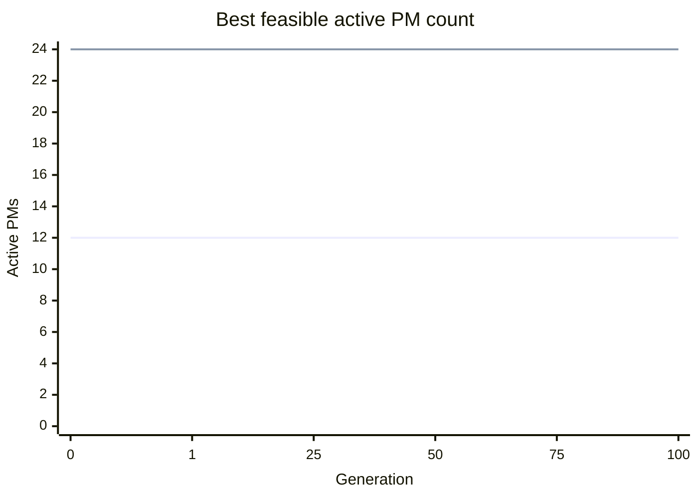
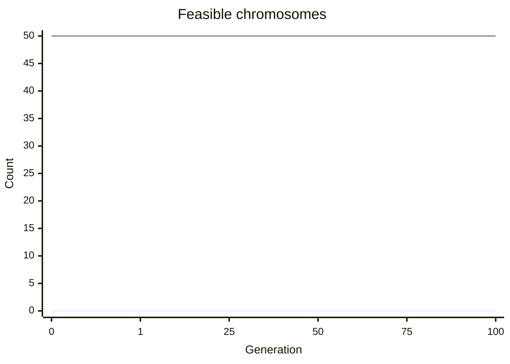

# GA Consolidation Diagnosis

Date: 2026-11-12

Scope: source inspection, saved-run inspection, hand calculation, and controlled artifact review. No GA source, configuration, or full PlanetLab experiment changed. No full PlanetLab optimization rerun.

## 1. Executive diagnosis

### Confirmed cause

The 24-PM run does load 24 PMs, but its random initialization assigns each of 1,033 VMs independently to `1..24`. This makes every PM active with overwhelming probability. The saved 24-PM population is feasible from generation 0, and every recorded best chromosome uses all 24 PMs. Since all feasible chromosomes with 24 active PMs tie at fitness `1.5`, selection has no consolidation gradient.

The 12-PM run has same structural behavior: its saved best chromosome uses all 12 PMs. It has too few feasible individuals for much of run, so infeasibility dominates before consolidation can be explored.

### Design limitations

1. Initialization is uniform over all available PM labels; it does not seed compact placements.
2. Mutation is independent per gene and reassigns to a random different PM. It does not target PM emptying.
3. Uniform crossover mixes labels from both parents and does not consolidate labels.
4. No repair, relocation, first-fit placement, PM-label canonicalization, or consolidation operator exists.
5. Saved history records fitness and active count only for the best-so-far chromosome. It does not record the requested population distribution or mutation events.

### No confirmed implementation bug

Placement validation, PM load dimensions, active-PM counting, PM range handling, and configured fitness denominator are implemented dynamically. No source-code hard-coded `12` was found in algorithm modules. Hard-coded `12` occurrences exist in tests, documentation, output validation for the approved 12-PM run, and window-size semantics; these are not active PM limits.

Parameter tuning alone is unlikely to fix this reliably. Higher mutation can increase exploration, but random reassignment still has extremely low probability of emptying a PM while preserving feasibility. A consolidation-directed search component is needed for dependable reduction.

## 2. Effective configuration

| Setting | Default `experiment_config.yaml` | 24-PM `experiment_p24.yaml` | Effective saved 24-PM artifact |
|---|---:|---:|---:|
| Available PM count | 12 | 24 | 24 |
| VM CPU capacity | 1.0 vCPU | 1.0 vCPU | 1.0 vCPU |
| PM CPU capacity | 16.0 vCPU | 16.0 vCPU | 16.0 vCPU |
| Safe CPU threshold | 0.80 | 0.80 | 0.80 |
| Population | 50 | 50 | 50 |
| Mutation | random reassignment, 0.02/gene | same | same |
| Crossover | uniform, 0.80 | same | same |
| Elitism | 2 | 2 | 2 |
| Fitness weights | server 0.70, migration 0.30 | same | same |
| Static migration objective | excluded | excluded | excluded |
| Master seed | 42 | 42 | 42 |
| RNG | NumPy PCG64 | NumPy PCG64 | PCG64 stream metadata |
| Max generations | 100 updates, plus generation 0 | same | 101 history rows |

Evidence:

- `configs/experiment_config.yaml:47-64`
- `configs/experiment_p24.yaml:47-64`
- `outputs/seed_42/summaries/experiment_config.json:54-76`
- `outputs_p24/seed_42/summaries/experiment_config.json` records `available_pm_count: 24`.

The 24-PM configuration is effective in `outputs_p24`; changing or inspecting only default configuration gives 12 PMs.

## 3. Hard-coded PM-limit search

### Algorithm source

No relevant hard-coded PM limit found in `src/*.py`.

- `genetic_algorithm.py:21,24`: initialization uses `rng.integers(1, pm_count + 1, ...)`.
- `genetic_algorithm.py:29`: reads `config["infrastructure"]["available_pm_count"]`.
- `mutation.py:15-16`: uses `pm_count` for valid reassignment.
- `placement.py:10,20-22`: validates and allocates arrays using `pm_count`.
- `evaluation.py:10-11`: reads configured PM count and passes it to load calculation.
- `fitness.py:11`: divides active count by configured PM count.

### Relevant literal occurrences

- `tests/test_ga.py:66,88,93,108,127,137`: fixed 12-PM operator tests.
- `tests/test_foundation.py:36,79,87,113,139-144`: fixed 12-PM foundation tests.
- `src/output_organization.py:183-191`: approved 12-PM output validation expectations.
- `src/output_documentation.py`: text and plots describe the approved 12-PM experiment.
- `GA_Server_Consolidation_EN_v4_RENDER_READY.md`: specification examples and approved baseline use 12.
- `configs/experiment_config.yaml:49`: default configuration is 12.
- `configs/experiment_p24.yaml:49`: test configuration is 24.

These occurrences can make tests/documentation misleading, but none caps runtime chromosomes at 12. Window size `12` is sample count, not PM count.

## 4. Chromosome representation

Representation: one integer allele per VM; allele is PM ID.

- Exactly one assignment per VM: `validate_placement` requires shape `(vm_count,)`.
- Valid range: `1 <= allele <= pm_count`.
- Both 12 and 24 are supported by the same dynamic range code.
- `pm_loads_vcpu` creates `(samples, pm_count)` and sums genes by PM ID.
- Active count is `len(np.unique(placement))`; unused PMs remain zero-load columns and are not counted.

Confirmed unused-PM behavior: `evaluation.py:13-14` counts only labels present in chromosome; `evaluation.py:29` computes active utilization only over those labels. No phantom PM activation found.

## 5. Fitness objective

Static feasible fitness:

```text
cost = active_pm_count / available_pm_count
fitness = 1 + 1 / (1 + cost)
```

Static infeasible fitness:

```text
fitness = 1 / (1 + normalized_cpu_violation)
```

Therefore:

- Every feasible fitness is greater than 1.
- Every infeasible fitness is at most 1.
- Fewer active PMs means lower cost and higher fitness among feasible chromosomes.
- Static fitness does not include migration cost. `fitness.py:12-17` adds migration only for `mode == "dynamic"`.
- The denominator comes from `config["infrastructure"]["available_pm_count"]`.
- More active PMs are not rewarded.

### Hand calculation

For feasible static chromosomes under 12 available PMs:

| Active PMs | Cost | Fitness |
|---:|---:|---:|
| 12 | `12/12 = 1` | `1.500000` |
| 11 | `11/12 = 0.916667` | `1.521739` |
| 10 | `10/12 = 0.833333` | `1.545455` |

Ranking: 10 PMs > 11 PMs > 12 PMs. Equal active counts produce identical static fitness, provided status and mode are otherwise the same. CPU load and migration do not break static ties.

This objective is correct. It is not the reason the GA prefers 24 PMs.

## 6. Saved convergence evidence

| Run | Feasible chromosomes per population | Best active count across history | Best fitness | Result |
|---|---:|---:|---:|---|
| 12-PM static GA | 0 to 9 | always 12 | 0.999968 to 1.500000 | No compact feasible chromosome found |
| 24-PM static GA | 49 to 50 | always 24 | always 1.500000 | All-feasible tie plateau |

Sources:

- `outputs/seed_42/experiments/static/ga/fitness_history.csv`
- `outputs_p24/seed_42/experiments/static/ga/fitness_history.csv`
- `outputs_p24/seed_42/summaries/experiment_summary.csv`

The 24-PM static GA starts with all 24 PMs active and remains there through all 101 history rows. Fitness convergence alone would hide this: fitness is flat at `1.5`, while the desired active count also remains flat at 24.

Existing dynamic summary shows the same result: `outputs_p24/.../experiment_summary.csv` reports cold and warm `mean_active_pm_count = 24`, minimum 24, maximum 24.

## 7. Mutation and crossover analysis

### Random reassignment mutation

`mutation.py:14-16` independently mutates each gene with probability 0.02 and chooses one of the other PMs uniformly.

- It can activate an unused PM if one exists and a mutated gene lands on it.
- It does not preserve active count. A mutation can activate or deactivate labels.
- Starting from a chromosome using every PM, no activation is needed; only emptying labels matters.
- With 1,033 VMs, a uniform 12-PM chromosome has about 86 genes per PM; with 24 PMs, about 43 genes per PM.
- Emptying one PM in one mutation requires moving every gene currently on that PM. Approximate direct probability is `(0.02 / (N-1))^k`, where `k` is PM occupancy. This is effectively zero for `k` in the tens.
- A generation mutates about `1033 * 0.02 = 20.66` genes per child on average, but these mutations are spread across PM labels and are not directed toward emptying one PM.

### Uniform crossover

`crossover.py:13-16` independently selects each child gene from either parent with probability 0.5 and returns complementary children.

- It preserves valid labels inherited from either parent.
- It can lose a PM label in principle.
- If a PM has `k` genes in a parent, probability that a child receives none of those genes from that parent is approximately `0.5^k`; this becomes small for normal occupancy.
- When both selected parents use all PMs, crossover usually preserves labels from both parents, not a compact PM subset.

### Search pressure conclusion

Tournament selection and elitism preserve equal-fitness all-PM chromosomes. Operators provide weak indirect pressure toward fewer PMs only after a feasible chromosome with fewer active labels appears. They provide no mechanism that deliberately creates such a chromosome. This is a design limitation, not evidence that mutation probability is numerically incorrect.

## 8. Controlled-test status

The repository already contains small controlled tests in `tests/test_foundation.py` and `tests/test_ga.py`:

- placement length, integer type, and PM range;
- PM load and unused-PM zero columns;
- feasible/infeasible CPU threshold;
- feasible fitness ordering;
- static exclusion of migration objective;
- mutation valid-range behavior;
- crossover valid-length behavior;
- reproducible seed 42 streams;
- 5-VM full pipeline.

The saved 12-PM and 24-PM static artifacts provide controlled configuration evidence without rerunning 1,033-VM PlanetLab optimization. Both use same dataset, seed 42, and GA settings; 24-PM effective configuration is confirmed in its saved metadata.

The requested new diagnostic population/event metrics are unavailable in existing history. Existing artifacts do not record mutation event counts, empty PM events, activated-empty-PM events, feasible active-count distributions, or per-generation population active-count distributions. A small diagnostic-only run is required to measure those directly. Runtime environment lacks installed NumPy (`ModuleNotFoundError: No module named 'numpy'`), so no new run was started.

## 9. Diagnostic table and plot

Existing history supports best active count and feasible population count:

| Generation range | 12-PM best active | 12-PM feasible population | 24-PM best active | 24-PM feasible population |
|---|---:|---:|---:|---:|
| 0 | 12 | 0 | 24 | 50 |
| 1–100 | 12 | 0–9 | 24 | 49–50 |

Plot from saved history:





The second plot uses endpoint ranges conservatively; exact 12-PM history varies from 0 to 9 and exact 24-PM history from 49 to 50. A future diagnostic run must save exact distribution bins and mutation event counters every generation.

## 10. Improvements, not implemented

Priority 1 — **D. Active-PM-aware initialization**

- Works: seed some chromosomes with a compact PM subset, then assign VMs into that subset.
- Benefit: creates feasible candidates with fewer active PMs from generation 0 when capacity allows.
- Disadvantage: naive compact assignment can overload PMs.
- Methodology: changes initialization distribution, but keeps chromosome and fitness methodology.
- Fair test: same seed, VM subset, population size, generations, and evaluation budget; compare feasible active-count distributions against uniform initialization.

Priority 2 — **C. Feasibility-preserving relocation**

- Works: move one VM only when destination remains within CPU threshold.
- Benefit: removes PMs while retaining feasibility.
- Disadvantage: local moves can stall; extra evaluation cost.
- Methodology: changes mutation operator and therefore requires approval.
- Fair test: compare equal population evaluations and report active count, feasibility, runtime, and migration separately.

Priority 3 — **A. Consolidation-aware mutation**

- Works: choose a PM, attempt to move all its VMs to other PMs, accept only feasible result.
- Benefit: directly attacks active-PM count and can empty PMs.
- Disadvantage: many moves fail; can disrupt good placements and increase computation.
- Methodology: materially changes search operator.
- Fair test: fixed operator-call budget, same seed set, same feasibility checks, compare PM reduction and overload.

Priority 4 — **B. First-fit or best-fit consolidation**

- Works: order VMs and place them into fewest PMs by remaining safe capacity.
- Benefit: strong constructive pressure and fast compact candidates.
- Disadvantage: greedy order sensitivity; may miss globally better placements.
- Methodology: adds heuristic initialization or repair; changes original GA methodology more than D/C.
- Fair test: run as separately named variant, same workload and seed, no hidden post-processing.

Priority 5 — **E. Adaptive mutation**

- Works: alter mutation behavior using active count and search stagnation.
- Benefit: can increase exploration after plateau.
- Disadvantage: more parameters and confounding; random reassignment still lacks direct consolidation unless behavior changes substantially.
- Methodology: changes parameter schedule/operator behavior.
- Fair test: predeclare schedule, use same evaluation budget, compare against fixed 0.02 baseline across same seeds.

## 11. Final answers

- 24 PMs are genuinely loaded by effective 24-PM configuration and saved artifacts.
- Chromosomes support 24 PM labels; no algorithm-source 12-PM cap found.
- Active PM counting is correct.
- Fitness correctly rewards fewer active PMs among feasible chromosomes and excludes static migration.
- 24-PM run fails to reduce active PMs because uniform initialization activates all labels, all candidates are feasible, fitness ties at 1.5, and operators almost never empty a PM.
- 12-PM run also remains at 12 active PMs, with feasibility scarcity making search harder.
- Parameter tuning alone is unlikely to reliably solve consolidation. Do not implement A–E until methodology approval.
